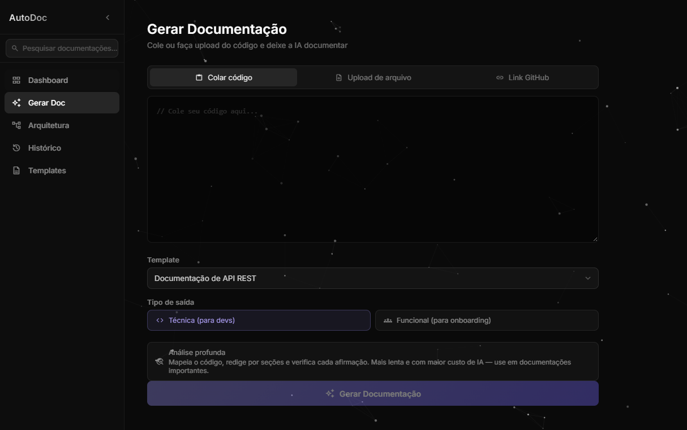

# AutoDoc

Documentação técnica de código gerada por IA, a partir de código colado, arquivos enviados ou repositórios do GitHub.

O AutoDoc lê o código, monta o contexto relevante e gera documentação em Markdown seguindo templates configuráveis. Também avalia, a cada commit, se a documentação existente ficou desatualizada, e pode publicá-la de volta no repositório.

> Projeto nascido como Trabalho de Conclusão de Curso em Análise e Desenvolvimento de Sistemas (FATEC Mogi Mirim) e continuado como projeto open source.



## Funcionalidades

- **Geração de documentação** a partir de código colado, upload de arquivos ou URL de repositório GitHub (público ou privado, com o token do próprio usuário).
- **Templates** de documentação técnica e funcional, editáveis, e criação de template a partir de um documento de exemplo.
- **Avaliação de atualização:** analisa o último commit e decide se a documentação precisa ser regenerada.
- **Publicação no GitHub:** commita a documentação gerada no repositório.
- **Agentes** *(experimental)*:
  - **Documentador**, com modo rápido e modo profundo (mapa do código por AST, geração por seções e verificação);
  - **Arquiteto**, que propõe e critica arquiteturas a partir de especificações ou de um repositório existente;
  - **Gerador de testes**, que gera e (opcionalmente) executa testes unitários.
- **Servidor MCP** *(experimental)*, para usar o AutoDoc dentro de Claude Code, Cursor ou VS Code.
- **Integração com CI**, com exemplo de pipeline do Azure DevOps.

## Stack

| Camada | Tecnologias |
|---|---|
| Backend | Python 3.11+, FastAPI, SQLAlchemy, Alembic, LangGraph |
| IA | OpenAI ou Anthropic |
| Banco | SQLite (padrão) ou PostgreSQL |
| Fila (opcional) | Redis + arq |
| Frontend | Angular 21 (standalone, signals), Angular Material |
| Integrações | API do GitHub, MCP |

## Como rodar

### Pré-requisitos

- Python 3.11 ou superior
- Node.js 20.19 ou superior
- Uma chave de API da OpenAI ou da Anthropic

### Backend

```bash
cd backend
python -m venv .venv
# Windows: .venv\Scripts\Activate.ps1
# Linux/macOS: source .venv/bin/activate
pip install -r requirements.txt
cp .env.example .env
```

Edite o `.env` e preencha ao menos a chave da IA e um `JWT_SECRET` aleatório:

```bash
python -c "import secrets; print(secrets.token_urlsafe(48))"
```

Para desenvolvimento local, o `.env.example` já vem com `APP_ENV=development` e `SEED_DEMO_USER=true`, que cria um usuário de demonstração. Depois:

```bash
python -m uvicorn app.main:app --reload --reload-dir app --host 127.0.0.1 --port 8000
```

A documentação da API fica em `http://127.0.0.1:8000/docs`.

Para criar um usuário sem o modo de demonstração:

```bash
python -m app.scripts.create_user --email voce@exemplo.com
```

### Frontend

```bash
cd frontend
npm ci
npm start
```

Acesse `http://localhost:4200`.

### Docker Compose (desenvolvimento)

```bash
cd infra
cp .env.example .env
docker compose up
```

Sobe API, worker, PostgreSQL e Redis. Veja os comentários em `infra/docker-compose.yml`.

### Testes

```bash
cd backend
pip install -r requirements-dev.txt
python -m pytest -q
```

## Configuração

As variáveis estão documentadas em [`backend/.env.example`](backend/.env.example). As principais:

| Variável | Para que serve |
|---|---|
| `LLM_PROVIDER`, `OPENAI_API_KEY`, `ANTHROPIC_API_KEY` | Provedor e chave da IA |
| `JWT_SECRET`, `APP_ENV` | Autenticação; em produção, a API recusa segredos fracos |
| `SEED_DEMO_USER`, `ALLOW_REGISTRATION` | Usuário de demonstração e cadastro aberto (ambos desligados por padrão) |
| `ALLOW_SERVER_GITHUB_TOKEN` | Se o token do servidor pode ser usado em nome dos usuários (desligado por padrão) |
| `TESTGEN_EXECUTION` | Se o gerador de testes executa o código gerado: `none`, `docker` ou `local` |
| `AGENT_RUN_TIMEOUT_SECONDS`, `LLM_TIMEOUT_SECONDS` | Limites de tempo das gerações |

Antes de expor uma instância, leia o [SECURITY.md](SECURITY.md).

## Decisões de projeto

- **Modelos locais (Ollama):** testamos o Ollama como provedor para eliminar o custo de tokens e manter o código na máquina do usuário. Em hardware sem GPU, a geração de um arquivo médio passou de 10 minutos, então o suporte foi removido por ora. Pode voltar quando houver streaming e pré-processamento que reduza o tamanho da entrada.
- **Custo:** documentar um repositório inteiro no modo rápido com `gpt-4o-mini` consome cerca de 35 mil tokens, o que custa frações de centavo de dólar.

## Roadmap

- Extensão para o VS Code
- Aplicativo desktop (Tauri)
- Núcleo compartilhado em TypeScript
- Suporte a provedores compatíveis com a API da OpenAI (Groq, Gemini, OpenRouter)

## Autores

- **Rafael Francisco da Silva** — [@r4faelFSilva](https://github.com/r4faelFSilva)
- **Vinícius Aquino da Cunha** — [@Viniquest](https://github.com/Viniquest)

## Licença

Distribuído sob a licença MIT. Veja [LICENSE](LICENSE).
